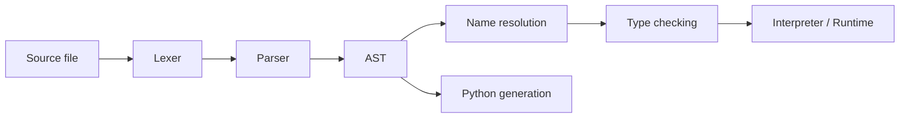
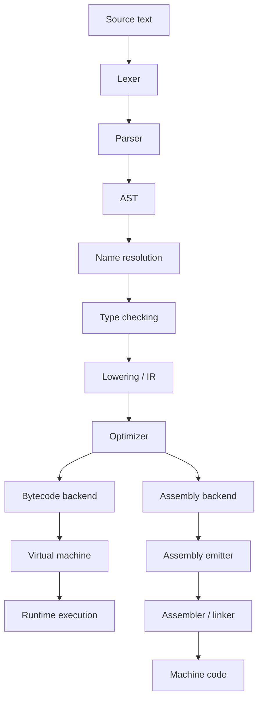
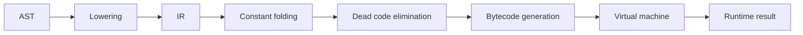
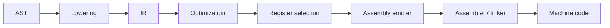
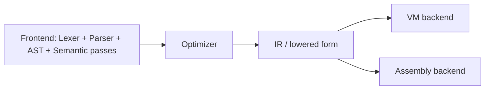

# Advanced / Future Work for MiniBASIC

This document collects the next compiler-level directions for the project after the current teaching-focused MVP. The goal is to keep the architecture readable while showing where the system can grow beyond the current interpreter and AST pipeline.

The project already has a clean foundation. The next step is not to add random complexity, but to show the real choices a compiler must make when it reaches the backend and optimization stages.

---

## Where we are now

The current compiler is already a complete teaching pipeline:



This is a strong educational base, because students can see the exact transformation from source text to executable meaning.

---

## What comes next: the compiler branches after the AST

Once the front end is stable, the compiler naturally moves into a shared middle-end, and then chooses a backend.



This diagram is the key idea: the AST is the central hub, and the backend is the decision point after semantic checking and lowering.

---

## Direction A: optimize toward bytecode and VM execution

This is the most natural continuation of the current project, because it stays close to the existing architecture.



### Typical additions

- `for` loops lowered into `while` form
- expression simplification via constant folding
- dead-code elimination for unreachable branches
- basic IR representation for easier pass composition
- stack-based instruction generation
- VM trace and debugging improvements

### Why this fits the project

This route preserves the learning-first spirit:

- the compiler still feels understandable
- the machine representation is explicit
- students can inspect generated bytecode, stack effects, and runtime behavior

This is often the best next step after the interpreter is already working.

---

## Direction B: optimize toward assembly and native machine code

This path goes one step further and turns the compiler into a true backend-oriented code generator.



### Typical additions

- simple register allocation strategy
- expression lowering into target ops
- jump and branch emission
- stack frame layout for function calls
- assembly output as an intermediate artifact
- object file generation and linking

### Why this is valuable

This is the path toward a “real compiler” in the classical sense:

- AST → lower-level IR
- IR → target instructions
- target instructions → assembly
- assembly → executable code

This is a very important conceptual step, but it is best introduced only after the student understands the front end and runtime model.

---

## Shared optimization layer

The optimizer is the bridge between understanding the language and generating real machine-facing code.



### Examples of optimization passes

- constant folding
- constant propagation
- unreachable branch pruning
- loop-invariant code motion
- dead branch elimination

These are meaningful teaching topics because they show that compiler work is not just parsing and execution, but the systematic rewriting of code into a better form.

---

## 1. Lowering and desugaring

Possible future work:

- transform `for` loops into while-style loops
- desugar `if`/`else` constructs into branch-based control flow
- lower user-friendly syntax into a simpler internal form
- introduce a small IR layer for later passes

Why this is important:

- lowering is a central compiler transformation concept,
- it shows that front-end syntax is often rewritten into a uniform machine-friendly form,
- and it prepares the project for optimization and code generation.

This is one of the first genuinely advanced topics worth teaching after the base compiler works.

---

## 2. Compiler passes and optimization pipeline

Possible future work:

- constant folding
- constant propagation
- dead code elimination
- verification passes that check invariants
- a pass pipeline with explicit input/output contracts

Why this matters:

- real compiler work is usually a sequence of passes,
- not one monolithic block of logic,
- and the project already follows a pass-based pipeline in spirit.

The teaching model should stay:

```text
AST
  ↓
resolved and typed AST
  ↓
IR or lowered form
  ↓
optimization passes
  ↓
execution or code generation
```

---

## 3. Arrays and collections

Possible future work:

- `array` type support
- literal arrays such as `[1, 2, 3]`
- index expressions like `values[0]`
- bounds checking
- mutation and assignment semantics

Why this is advanced:

- arrays require richer type rules,
- a more expressive AST,
- and a runtime storage model beyond simple scalar variables.

This is a natural next step after the project has a stable symbol table and type checker.

---

## 4. Functions and procedural abstraction

Possible future work:

- function declarations
- parameters and returns
- recursive calls
- call expressions
- call frames and runtime stack behavior

Why this is advanced:

- function binding introduces more complex scope management,
- runtime evaluation requires activation records,
- and the program model becomes more realistic.

This is an excellent follow-up to lexical scoping and symbol binding.

---

## 5. Bytecode and virtual machine

Possible future work:

- `OpCode` enum
- constant pool
- stack-based execution
- local variable storage
- jumps and branches
- simple VM instruction set
- disassembler or debugging output

Why this is valuable:

- it shows how a high-level language becomes executable instructions,
- and it connects the compiler to a more machine-like runtime.

Why it is not in the core plan:

- it adds another substantial execution layer,
- and it can distract from the original educational goal if introduced too early.

---

## 6. Backend strategy and optimization modes

Possible future work:

- interpreter backend
- bytecode backend
- optimized backend
- explicit `OptimizationStrategy` object

Why it matters:

- once the compiler has multiple execution modes, the selection logic becomes a real design concern,
- and `Strategy` is a clean fit for that problem.

This is a meaningful pattern for a later stage, not the first stage of the course.

---

## 7. Better tooling and feedback

Possible future work:

- pretty-printed AST output
- richer diagnostics with source context
- parser recovery and error continuation
- artifact snapshots for each compiler phase
- incremental compilation support

Why it belongs later:

- these features improve the developer experience,
- but they are not required to understand the compiler itself.

---

## 8. Patterns to teach later, not earlier

The project should not force every idea into a formal GoF pattern. The right advanced topics are:

- lowering / desugaring
- compiler pass composition
- strategy for backend or optimization choice
- emitter / builder for bytecode output
- runtime state and stack frames

These are meaningful additions to the course, but they should be introduced at the point when the underlying compiler concepts are already understood.

---

## Suggested order for future work

Once the base compiler is stable, the most natural next steps are:

1. lowering and IR
2. optimization passes
3. arrays
4. functions and call frames
5. bytecode and VM
6. backend strategy and tooling improvements

This sequence keeps the learning curve steady and avoids overwhelming students before they understand the main pipeline.

---

## Final rule

Advanced compiler concepts should be introduced only when the earlier stages are already clear.

The project’s real product is the educational journey from source text to execution, not a premature jump into a full industrial compiler architecture.
