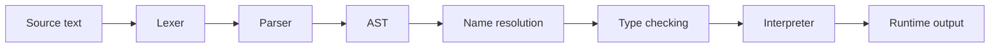

# Interpreter in MiniBasic

The interpreter is the current runtime stage of the MiniBasic compiler. It is intentionally simple and educational: it takes a validated AST and executes it directly, without first lowering the program into bytecode or machine code.

This makes it a perfect teaching tool, because students can see the exact meaning of the AST in runtime terms.

## Role in the compiler pipeline

The interpreter sits after semantic validation and before runtime output.

## What it does

The interpreter walks every statement in the program and evaluates it in order.

### Statement execution

- variable declaration: create a variable in the runtime environment
- assignment: update the variable value
- print: evaluate the expression and write the result
- if: evaluate the condition and execute one branch
- while: repeat while the condition remains true
- block: execute nested statements in sequence

### Expression evaluation

The interpreter evaluates expressions recursively:

- literals: return their value
- variables: read from the environment
- unary expressions: apply `!`, `-`, or `+`
- binary expressions: evaluate left and right operands, then apply the operator

Examples:

- `2 + 3` → `5`
- `x < 10` → `true` or `false`
- `!blocked` → logical negation

## Why this is useful

The interpreter is useful because it gives a direct answer to the question: “what does this AST mean at runtime?”

It is a reference execution model, which makes it easier to understand:

- control flow
- variable state
- expression evaluation
- runtime semantics

This is also a good baseline before moving to more advanced compiler stages such as lowering, bytecode generation, optimization, and native code generation.

## Why it is not the final backend

The interpreter is intentionally simple. It does not lower code into a more machine-friendly representation, and it does not emit assembly or bytecode. It directly evaluates the AST instead.

That makes it ideal for teaching, but it is not the same as a production backend.

The future stages of the project are:

- lowering to IR
- optimization passes
- bytecode backend
- assembly / machine-code backend

## Summary

The interpreter is the current runtime layer of the compiler. It is a direct AST executor and a teaching-first execution engine. It lets students observe what a valid MiniBasic program actually does before the project evolves into more advanced backend-oriented stages.
