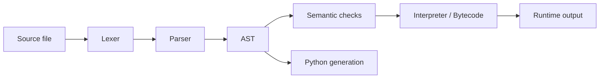

# MiniBasic Compiler

A teaching-first compiler prototype written in C# for .NET 10. This project is designed as a hands-on example of how a small language can move from source text to tokens, AST, semantic checks, bytecode, runtime execution, and generated Python.

This repository is intentionally educational: the goal is not to build a production optimizer or a full commercial language runtime, but to make each compiler stage visible and easy to understand.

## Why this project exists

This project demonstrates the classic compiler pipeline in a compact and approachable form:



You can read the source, inspect the generated artifacts, and see how each stage transforms the program.

## Supported language features

The language is a small BASIC-like language designed for teaching. The current syntax includes:

- variable declarations with `var name := value`
- integer and floating-point numeric literals
- boolean literals: `true` and `false`
- strings with double quotes
- arithmetic operators: `+`, `-`, `*`, `/`
- comparisons: `=`, `!=`, `<`, `>`, `<=`, `>=`
- logical operators: `&&`, `||`, `!`
- `if ... then ... else ... endif`
- `while ... do ... endwhile`
- `print(...)`

A full specification is documented in [LanguageSpecification.md](LanguageSpecification.md).

## Project structure

```text
.
├── BasicCompiler/
│   ├── BasicCompiler.csproj
│   ├── Program.cs
│   ├── sample.bas
│   ├── Cli/
│   ├── Syntax/
│   ├── Diagnostics/
│   ├── Bytecode/
│   ├── Runtime/
│   ├── Semantics/
│   └── CodeGeneration/
├── BasicCompiler.Tests/
├── output/
├── examples/
├── sample.bas
├── LanguageSpecification.md
├── IMPLEMENTATION_PLAN.md
├── ADVANCED_FUTURE_WORK.md
├── MEDIUM_ARTICLE.md
├── AGENTS.md
├── AGENTS-guardrails.md
├── .github/
├── .gitignore
└── README.md
```

## Quick start

### 1. Build the project

```bash
dotnet build
```

### 2. Run the bundled example

```bash
dotnet run --project BasicCompiler/BasicCompiler.csproj -- sample.bas
```

This executes the default program in [sample.bas](sample.bas) through the interpreter.

### 3. Generate Python from the AST

```bash
dotnet run --project BasicCompiler/BasicCompiler.csproj -- python sample.bas
```

This reads the MiniBasic source, parses it into an AST, and emits a Python equivalent in [output/08-python.py](output/08-python.py).

### 4. Inspect compiler artifacts

```bash
dotnet run --project BasicCompiler/BasicCompiler.csproj -- lex sample.bas
dotnet run --project BasicCompiler/BasicCompiler.csproj -- parse sample.bas
dotnet run --project BasicCompiler/BasicCompiler.csproj -- check sample.bas
dotnet run --project BasicCompiler/BasicCompiler.csproj -- bytecode sample.bas
```

These commands produce outputs in the [output](output) folder.

## Source to output pipeline

The project writes intermediate artifacts so learners can inspect what happens at each stage.

### Input source

- [sample.bas](sample.bas)
- [examples](examples)

### Generated outputs

- [output/01-tokens.txt](output/01-tokens.txt) — lexical tokens
- [output/02-ast.txt](output/02-ast.txt) — parsed abstract syntax tree
- [output/03-symbols.txt](output/03-symbols.txt) — symbol table / name resolution
- [output/04-diagnostics.txt](output/04-diagnostics.txt) — semantic and syntax diagnostics
- [output/05-runtime.txt](output/05-runtime.txt) — execution result
- [output/06-bytecode.txt](output/06-bytecode.txt) — lowered bytecode
- [output/07-vm-trace.txt](output/07-vm-trace.txt) — virtual machine execution trace
- [output/08-python.py](output/08-python.py) — Python translation produced from AST

These files are helpful for teaching because they show the exact compiler story instead of only the final result.

## Example program

The bundled program is intentionally small but covers many language ideas:

```basic
var start := 0
var limit := 5
var total := 0
var counter := 0
var name := "Ada"
var enabled := true
var blocked := false

if (enabled && !blocked) || start = 0 then
    print("compiler start")
else
    print("compiler blocked")
endif

while counter < limit do
    total := total + (counter * 2)
    counter := counter + 1
endwhile

var average := total / limit
var done := counter >= limit && total != 0
var isSmall := total < 10
var isEqual := total = 10
var isNotEqual := total != 11
var isLessOrEqual := average <= 5
var isGreaterOrEqual := average >= 2
```

The generated output demonstrates both control flow and expression evaluation in a way that is easy to follow in class or in a workshop.

## Documentation

Related project documents:

- [LanguageSpecification.md](LanguageSpecification.md) — language rules and grammar overview
- [IMPLEMENTATION_PLAN.md](IMPLEMENTATION_PLAN.md) — current implementation roadmap
- [ADVANCED_FUTURE_WORK.md](ADVANCED_FUTURE_WORK.md) — future compiler and research ideas
- [MEDIUM_ARTICLE.md](MEDIUM_ARTICLE.md) — article-style explanation of the project and approach
- [AGENTS.md](AGENTS.md) — repository guidance for coding agents
- [AGENTS-guardrails.md](AGENTS-guardrails.md) — guardrails and development constraints

## Status

This project is best understood as a proof-of-concept educational compiler and a reference implementation for learning compiler construction in a modern C# environment.

It is not a full production-grade language ecosystem, but it is a solid teaching artifact for understanding:

- lexing
- parsing
- AST design
- symbol resolution
- type checking
- runtime interpretation
- bytecode generation
- tracing and debugging
- AST-to-Python generation

## License

This project is intended for educational use in a learning and demonstration context.

---

If you want, the next step can be to add a small GitHub-friendly screenshot section, a contribution section, or a concise architecture diagram tailored for the repository landing page.
